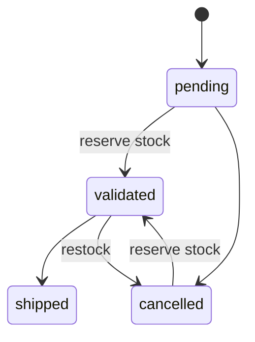

# DigiMarket API

REST API for the DigiMarket e-commerce platform, built with Flask, SQLAlchemy
(SQLite) and JWT authentication.

## Requirements

- [uv](https://docs.astral.sh/uv/) for dependency and environment management
- Python >= 3.12 (uv installs a suitable interpreter automatically)

## Install

```bash
uv sync
```

This creates an isolated virtual environment and installs both the runtime and
the dev dependencies.

## Configuration

Settings have dev-friendly defaults and are overridden with environment
variables:

| Variable | Default | Purpose |
|----------|---------|---------|
| `JWT_SECRET_KEY` | `change-me-in-prod` | Secret used to sign JWTs. Set a strong value in production. |
| `DATABASE_URL` | `sqlite:///app.db` | SQLAlchemy database URI. |

```bash
export JWT_SECRET_KEY="a-long-random-secret"
```

## Initialize the database

Create the tables, then (optionally) load some test data:

```bash
uv run flask --app app init-db
uv run flask --app app seed
```

`seed` is idempotent: re-running it skips anything already present.

To promote an existing user to admin:

```bash
uv run flask --app app grant-admin --email client@digimarket.com
```

### Seeded data

**Users** (email / password):

| Role | Email | Password |
|------|-------|----------|
| admin | `admin@digimarket.com` | `AdminPass123` |
| client | `client@digimarket.com` | `ClientPass123` |

**Products:**

| Name | Category | Price | Stock |
|------|----------|------:|------:|
| Clavier mécanique RGB | Périphériques | 89.99 | 40 |
| Souris gaming sans fil | Périphériques | 49.99 | 60 |
| Écran 27" 144 Hz | Écrans | 299.00 | 15 |
| SSD NVMe 1 To | Stockage | 109.90 | 80 |

**Orders:** two `pending` orders for the seed client (one with 1x Clavier and
2x Souris, one with 1x Écran). They are left pending on purpose, since stock is
only consumed once an admin validates an order.

## Run the app

```bash
uv run flask --app app run
```

## Quickstart

Register, log in to get a token, then call an authenticated route with it:

```bash
# 1. Create a client account
curl -X POST http://127.0.0.1:5000/api/auth/register \
  -H "Content-Type: application/json" \
  -d '{"email": "alice@example.com", "password": "StrongPass123", "name": "Alice"}'

# 2. Log in and capture the access token
TOKEN=$(curl -s -X POST http://127.0.0.1:5000/api/auth/login \
  -H "Content-Type: application/json" \
  -d '{"email": "alice@example.com", "password": "StrongPass123"}' \
  | python -c "import sys, json; print(json.load(sys.stdin)['access_token'])")

# 3. Call an authenticated route with the bearer token
curl http://127.0.0.1:5000/api/orders -H "Authorization: Bearer $TOKEN"
```

Admin-only routes need an admin token: log in with the seeded admin account
(`admin@digimarket.com` / `AdminPass123`) instead at step 2.

## API documentation

With the app running, the OpenAPI docs are served under `/api/docs`:

- Swagger UI: http://127.0.0.1:5000/api/docs/swagger
- ReDoc: http://127.0.0.1:5000/api/docs/redoc
- Raw OpenAPI spec: http://127.0.0.1:5000/api/docs/openapi.json

Use the **Authorize** button in Swagger UI to send a JWT (obtained from
`POST /api/auth/login`) on the protected routes.

## Endpoints

Access: **Public** (no token), **Auth** (any logged-in user), **Admin** (admin only).

| Method | Path | Access | Description |
|--------|------|--------|-------------|
| POST | `/api/auth/register` | Public | Create a client account |
| POST | `/api/auth/login` | Public | Log in, returns a JWT access token |
| GET | `/api/products` | Public | List products (paginated; `search`, `sort`, `order`, `page`, `per_page`) |
| GET | `/api/products/<id>` | Public | Get one product |
| POST | `/api/products` | Admin | Create a product |
| PUT | `/api/products/<id>` | Admin | Update a product |
| DELETE | `/api/products/<id>` | Admin | Delete a product |
| GET | `/api/orders` | Auth | List orders (clients see their own, admins see all; `user_id` filter for admins) |
| POST | `/api/orders` | Auth | Place an order |
| GET | `/api/orders/<id>` | Auth | Get one order (owner or admin) |
| PATCH | `/api/orders/<id>` | Admin | Change an order's status |
| GET | `/api/orders/<id>/items` | Auth | List an order's items (owner or admin) |

## Response format

### Lists

List endpoints (`GET /api/products`, `GET /api/orders`) return a pagination
envelope; the rows are under `items`:

```json
{
  "items": [],
  "page": 1,
  "per_page": 20,
  "total": 42,
  "pages": 3
}
```

### Errors

Errors return the matching HTTP status code and a JSON body:

```json
{ "error": "Email already registered" }
```

## Order status workflow

An order moves through four statuses. Only an admin changes it, via
`PATCH /api/orders/<id>`. Stock is reserved exactly while an order is
`validated`: validating consumes stock, cancelling a validated order gives it
back, and an order can only ship once it has been validated.



Only these transitions are allowed; each has a defined stock effect:

| From | To | Stock effect |
|------|-----|--------------|
| pending | validated | reserve (decrement) |
| pending | cancelled | none |
| validated | shipped | none |
| validated | cancelled | restock (re-increment) |
| cancelled | validated | reserve (decrement) |

Any other transition (for example `pending -> shipped`, or re-validating an
already validated order) is rejected with **409**. Validating when a product
lacks the required stock is also rejected with **409**, atomically: nothing is
decremented and the order stays unvalidated.

## Run the tests

```bash
uv run pytest
```

Lint and formatting (the same checks the CI runs):

```bash
uv run ruff check .
uv run ruff format --check .
```
